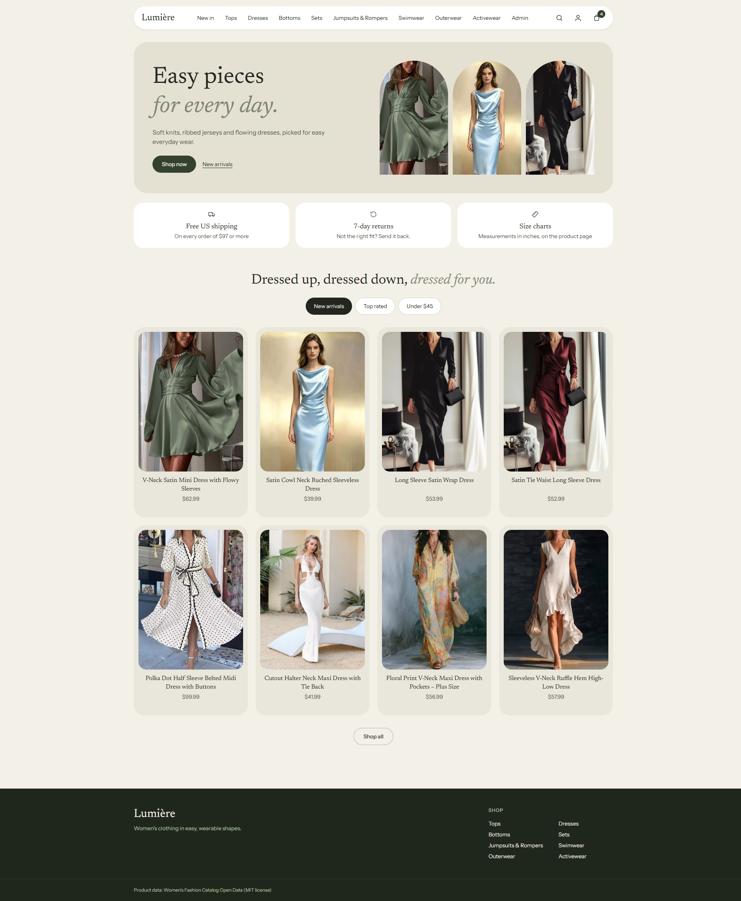
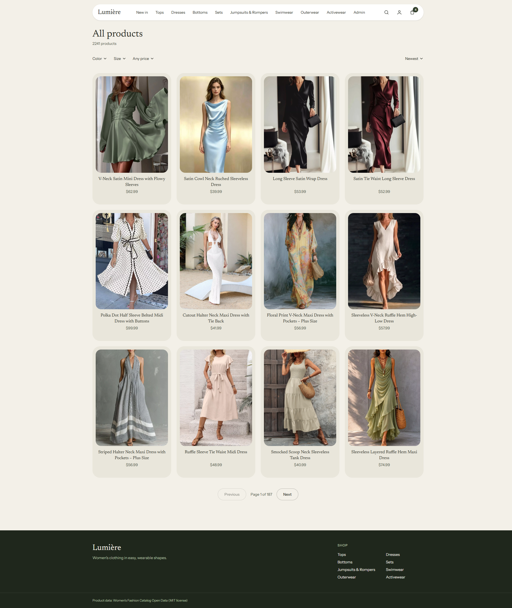
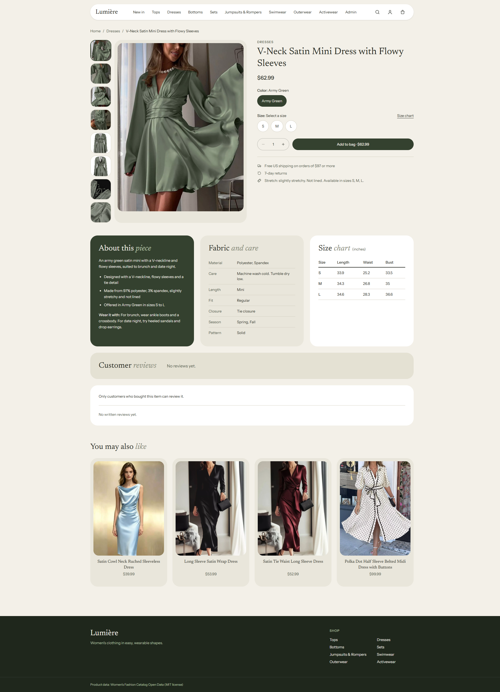
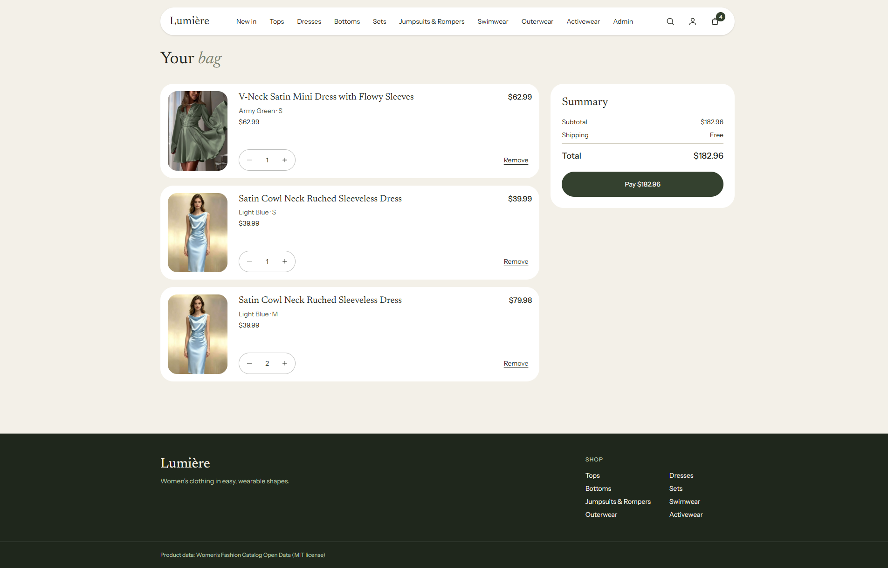
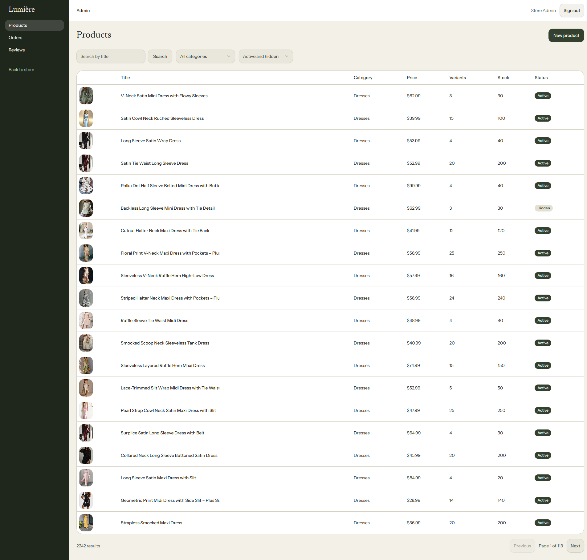
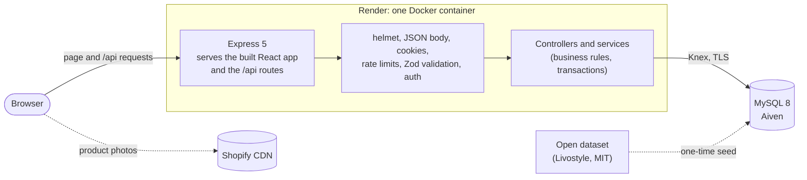

# Lumière

[](https://github.com/HT-126/e-commerce-v2/actions/workflows/ci.yml)

A full-stack online store for women's clothing, with a shop for customers and an admin area for the owner: React, Express and MySQL, with 2,242 real products.

**Live demo: https://e-commerce-v2-2ceg.onrender.com/**

> Free hosting: the first visit may take about a minute to wake up.

Payment is a mock (no real money moves) and the store is a portfolio project, not a real shop.

## Table of contents

- [Screenshots](#screenshots)
- [Features](#features)
- [Tech stack](#tech-stack)
- [Architecture](#architecture)
- [Project structure](#project-structure)
- [Database](#database)
- [API design](#api-design)
- [Demo logins](#demo-logins)
- [Run locally](#run-locally)
- [Tests](#tests)
- [Data](#data)
- [Project notes](#project-notes)

## Screenshots

<table>
  <tr>
    <td width="50%"><br><sub>Home</sub></td>
    <td width="50%"><br><sub>Shop: filters, sort, paging</sub></td>
  </tr>
  <tr>
    <td width="50%"><br><sub>Product: colors, sizes, size chart, reviews</sub></td>
    <td width="50%"><br><sub>Bag and checkout summary</sub></td>
  </tr>
  <tr>
    <td colspan="2"><br><sub>Admin: products</sub></td>
  </tr>
</table>

## Features

**Shop**
- 2,242 products in 8 categories, imported from an open dataset (see Data below).
- Filter by color, size and price, sort, search by title from the header, and paging.
- Product page with a photo gallery, color and size choice (only sizes in stock can be bought), fabric and care details, a size chart in inches, customer reviews and related products.
- A bag that works without an account (kept in the browser, up to 50 lines) and is merged into your account when you sign in. Totals are always computed by the server; shipping is free from $97 and a flat $6.95 below that.

**Accounts and orders**
- Register, sign in and sign out. The session is a JWT in an httpOnly cookie, with a "remember me" option. Sign-in and register are rate limited.
- Mock payment in one database transaction: stock is checked and taken together with the order, and pressing Pay twice makes only one order.
- Order history and an order detail page.

**Reviews**
- Anyone can read reviews. Only a customer whose order of that product was delivered can rate (1 to 5 stars) and comment; they can edit or delete their own review. The product's average rating updates with each change.

**Admin** (`/admin`, admin role only; the role is checked in the database on every request)
- Products: list with search and filters, create, edit, and hide from or show in the shop (nothing is deleted).
- Variants: add a color and size, and set the exact stock.
- Orders: change the status (paid, shipped, delivered, or cancelled); cancelling a paid order gives the stock back once.
- Reviews: list and delete.

**Engineering**
- Input validated with Zod on every route; passwords hashed with bcrypt; security headers with helmet; one central error handler and a consistent `{ data }` / `{ error }` response format.
- Money is stored as integer cents. Stock changes use conditional updates and row locks, so two buyers can never take the same last item.
- Automated tests on three layers (unit, API against a real MySQL test database, components), and a CI workflow on GitHub Actions.
- The whole app runs from one Docker image.

## Tech stack

| Part | Tools |
|---|---|
| Client | React 19, Vite, Tailwind CSS v4, React Router, TanStack Query, Zustand, React Hook Form + Zod |
| Admin UI | shadcn/ui (Radix), TanStack Table |
| Server | Node.js, Express 5, Knex, mysql2, Zod, bcrypt, JSON Web Tokens, helmet, express-rate-limit |
| Database | MySQL 8 |
| Tests | Vitest, Supertest, React Testing Library |
| Tooling | Docker and Docker Compose, GitHub Actions, ESLint (server), oxlint (client), Postman collection for manual API checks |
| Hosting (demo) | Render (free Docker web service) and Aiven (free MySQL) |

JavaScript only, no TypeScript.

## Architecture



The browser talks to one origin: Express serves the built client and the API, so the session cookie is same-origin and no CORS is needed. In development, Vite serves the client and proxies `/api` to Express.

## Project structure

```
e-commerce-v2/
├── client/                     # React app (Vite)
│   └── src/
│       ├── pages/              # one folder per page: home, shop, product, cart, orders, auth, admin
│       ├── components/         # shared shop UI (ProductCard, Header, filters, ...)
│       │   ├── admin/          # AdminLayout, DataTable, StatusBadge, ...
│       │   └── ui/             # shadcn/ui files, generated, used by the admin area only
│       ├── services/           # API calls
│       ├── hooks/              # TanStack Query hooks
│       ├── stores/             # Zustand store (the guest bag)
│       └── lib/                # small helpers: money, dates, query string, safe redirect
├── server/
│   ├── src/
│   │   ├── routes/             # URL and middleware wiring only
│   │   ├── controllers/        # read the request, call a service, send the response
│   │   ├── services/           # business rules and Knex queries
│   │   ├── schemas/            # Zod schemas for request input
│   │   ├── middleware/         # auth, require-admin, validate, rate-limit, error-handler
│   │   ├── utils/              # session cookie, order numbers, rating formula, color groups
│   │   └── config/env.js       # reads and checks the environment variables
│   ├── db/
│   │   ├── migrations/         # the schema, as Knex migrations
│   │   └── seeds/              # catalog import, demo customer, admin, demo order
│   ├── scripts/                # data download and the Docker start script
│   └── tests/                  # unit/, api/, db/ (+ fixtures/, helpers/)
├── postman/                    # collection for manual API checks
├── docker/init.sql             # creates the test database when the MySQL volume is new
├── docker-compose.yml          # MySQL (and the whole app with --profile app)
├── Dockerfile                  # builds the client and runs client + API in one image
└── .github/workflows/ci.yml    # CI: lint, tests and build for client and server
```

Each request goes **route → controller → service**. Routes only attach middleware; controllers have no business logic; services hold the rules and the Knex queries and know nothing about `req` or `res`.

## Database

MySQL 8, with the schema built only by Knex migrations.

| Table | Contents |
|---|---|
| `users` | Name, email (unique, lower case), bcrypt hash, role (`customer` or `admin`) |
| `categories` | 8 flat categories with a slug and a menu position |
| `products` | Slug, title, description, price, shown and original rating, details (material, care, fit, ...), size chart (JSON), `is_active` |
| `product_images` | Photo URLs with a position (0 is the main photo) |
| `variants` | One row per color and size: SKU, `color_group` for the filter, `stock` |
| `cart_items` | Signed-in users' bags: one row per user and variant, quantity 1 to 9 |
| `orders` | Order number, status (`paid`, `shipped`, `delivered`, `cancelled`), subtotal, shipping, total, email |
| `order_items` | A copy of what was bought: title, color, size, photo, unit price, quantity |
| `reviews` | One per user and product: rating 1 to 5, optional comment |

- Money is an integer number of cents (`*_cents`), never a float.
- Real foreign keys everywhere. Unique keys: one variant per product, color and size; one cart line per user and variant; one review per user and product. `CHECK` constraints keep `stock >= 0` and `rating` between 1 and 5.
- `order_items` is a snapshot, so an order never changes when a product's price or title changes. If a variant is deleted later, its order lines keep their data.
- `products.rating_avg` and `review_count` are recomputed in the same transaction as every review change. The dataset's own ratings are kept separately and counted in.
- The guest bag is not stored in the database, only the browser's.
- The dataset's 502 raw color names are mapped to 14 color groups by one function and stored in `variants.color_group`, so the color filter is a plain indexed query.

## API design

A JSON REST API under `/api`. Pages and API share one origin, so the session cookie is same-origin and no CORS setup is needed. This section is a summary; the full contract (every field, limit and error) is in `.claude/knowledge/api.md`, and `postman/` has a collection to try every route.

### Conventions

- **Success:** `{ "data": ... }`. **Failure:** `{ "error": { "message": "...", "code": "...", "details": [] } }`. `code` is one of a fixed list (below) and `details` is only there when it helps, for example the invalid fields of a form.
- **Money** is always integer cents (`priceCents: 6299` is $62.99). **Dates** are ISO 8601 strings.
- **Input** is checked with a Zod schema on every route that takes any. Bad input gets `400 VALIDATION_ERROR` before a service runs.
- **Paging:** `page` and `limit`. A `limit` above the maximum is rejected with `400`, not silently cut.
- **Prices and totals are computed on the server.** The browser only sends variant ids and quantities.
- **Customer routes never return stock numbers.** A variant is shown as in stock or sold out. Only admin routes return exact stock.
- **Admin:** one check guards the whole `/api/admin` path, so a new admin route cannot forget it.

| Status | Code | Meaning |
|---|---|---|
| 400 | `VALIDATION_ERROR` | Input failed its schema (`details` lists the problems) |
| 400 | `CART_EMPTY`, `CART_NOT_READY` | Pay with an empty bag, or a line that is sold out or short of stock |
| 400 | `INVALID_STATUS_CHANGE` | An admin tried an order status change that the rules do not allow |
| 401 | `UNAUTHORIZED` | Not signed in, or the session ended |
| 401 | `INVALID_CREDENTIALS` | Wrong email or password (the same message for both) |
| 403 | `FORBIDDEN` | Signed in, but not an admin |
| 403 | `NOT_PURCHASED` | Reviewing a product without a delivered order for it |
| 404 | `NOT_FOUND` | Unknown or hidden product, or another user's order |
| 409 | `EMAIL_TAKEN`, `SLUG_TAKEN`, `SKU_TAKEN`, `VARIANT_TAKEN` | Something that must be unique already exists |
| 409 | `STOCK_CHANGED` | Not enough stock when paying (`details` lists the lines) |
| 429 | `RATE_LIMITED` | Too many attempts; the response has `RateLimit` headers |

### Auth

The session is the cookie `token`: a JWT that holds only the user id, `httpOnly`, `SameSite=Lax`, `Secure` over HTTPS. It lasts 1 day, or 30 days with "remember me".

| Method and path | Auth | What it does |
|---|---|---|
| `POST /api/auth/register` | no | Body `{ firstName, lastName, email, password, acceptTerms }`. Password 8 to 72 bytes. Creates a `customer`, signs in, `201`. `409 EMAIL_TAKEN`, `429` |
| `POST /api/auth/login` | no | Body `{ email, password, remember? }`. Sets the cookie. A wrong email and a wrong password give the same `401`. `429` after 10 failed tries |
| `POST /api/auth/logout` | yes | Clears the cookie, `204` |
| `GET /api/auth/me` | yes | `{ id, firstName, lastName, email, role }`. The client calls it on load to know who is signed in |

### Catalog

| Method and path | Auth | What it does |
|---|---|---|
| `GET /api/categories` | no | The 8 categories in menu order |
| `GET /api/filters` | no | The color groups and sizes that exist on active products, for the filter menus |
| `GET /api/products` | no | A page of product cards. Query: `category` (slug), `q` (search in the title), `color` and `size` (comma lists), `minPriceCents`, `maxPriceCents`, `sort` (`newest`, `rating`, `price_asc`, `price_desc`), `page`, `limit` (default 12, max 48) |
| `GET /api/products/:slug` | no | One product: photos, details, size chart, and its variants with `inStock`. `404` for a hidden product |
| `GET /api/products/:slug/related` | no | Up to 4 products from the same category |

- Color and size filters match **in-stock** variants only, on the same variant: "black" and "M" finds products that have a black M in stock.
- Hidden products (`is_active = false`) never appear in lists, and their page is `404`.
- The home tabs are plain queries: New arrivals is `sort=newest`, Top rated is `sort=rating`, Under $45 is `maxPriceCents=4499`.

### Reviews

| Method and path | Auth | What it does |
|---|---|---|
| `GET /api/products/:slug/reviews` | no | Reviews with a comment, newest first, with the author as "Anna K." |
| `GET /api/products/:slug/reviews/mine` | yes | Your review (or `null`) and `canReview` |
| `PUT /api/products/:slug/reviews/mine` | yes | Create or update your review: `{ rating: 1-5, comment? (max 1000) }`. `403 NOT_PURCHASED` unless you have a **delivered** order for the product. Returns the new `ratingAvg` and `reviewCount` |
| `DELETE /api/products/:slug/reviews/mine` | yes | Delete your review and recompute the rating |

One review per user and product. The shown rating is recomputed in the same transaction as every change.

### Bag

A guest's bag lives in the browser as `{ variantId, quantity }` pairs. The server prices it and never trusts a client price.

| Method and path | Auth | What it does |
|---|---|---|
| `POST /api/cart/quote` | no | Prices a guest bag: `{ items: [{ variantId, quantity }] }` (up to 50 lines) |
| `GET /api/cart` | yes | The signed-in user's bag, priced |
| `PUT /api/cart/items/:variantId` | yes | Set one line's quantity (1 to 9); creates the line if needed |
| `DELETE /api/cart/items/:variantId` | yes | Remove a line |
| `POST /api/cart/merge` | yes | After sign-in: merge the guest bag into the account (the larger quantity per line wins) |

Every route that returns a bag returns the same shape: the lines, `subtotalCents`, `shippingCents` (free from $97, else $6.95), `totalCents` and `canCheckout`. Each line has a `status`: `ok`, `not_enough` or `sold_out`. Only `ok` lines count in the totals, and `canCheckout` is true only when every line is `ok`.

### Orders

| Method and path | Auth | What it does |
|---|---|---|
| `POST /api/orders` | yes | **Pay.** Turns the signed-in user's bag into an order. No body. The payment is a mock and always succeeds, unless stock is short |
| `GET /api/orders` | yes | Your orders, newest first, paged |
| `GET /api/orders/:orderNumber` | yes | One of your orders. Someone else's order is `404` |

Pay runs in **one database transaction**: lock the user's bag rows, check every line is `ok`, take the stock with a conditional update (`WHERE stock >= quantity`, in a fixed variant order so two orders can never wait on each other), create the order and a copy of its lines with status `paid`, and empty the bag. If any line fails, nothing changes. Because the bag rows are locked first, pressing Pay twice makes one order, and the second request gets `400 CART_EMPTY`.

### Admin

Every route here needs the `admin` role: `401` when signed out, `403` for a customer.

| Method and path | What it does |
|---|---|
| `GET /api/admin/products` | List including hidden ones. Query: `q`, `category`, `active`, `sort`, `page`, `limit` (max 100). Shows variant count and total stock |
| `GET /api/admin/products/:id` | One product with every variant and its exact stock |
| `POST /api/admin/products` | Create a product (1 to 10 photos, a unique slug). It starts with no variants |
| `PATCH /api/admin/products/:id` | Change any fields, including `isActive` to hide it from or show it in the shop. There is **no delete**: hiding keeps old orders intact |
| `POST /api/admin/products/:id/variants` | Add a color and size with a SKU and a stock. `409` for a duplicate SKU or color and size |
| `PATCH /api/admin/variants/:id` | Change the exact stock, color or size. To take a color or size off sale, set its stock to 0 |
| `GET /api/admin/orders`, `GET /api/admin/orders/:orderNumber` | All customers' orders, filtered by status or searched by order number or email; the detail shows the customer and the `allowedStatuses` |
| `PATCH /api/admin/orders/:orderNumber` | Change the status. Allowed: `paid` → `shipped` → `delivered`, and `paid` → `cancelled`. Anything else is `400 INVALID_STATUS_CHANGE`. Cancelling gives the stock back in the same transaction, once even if two requests arrive together |
| `GET /api/admin/reviews`, `DELETE /api/admin/reviews/:id` | List and delete reviews; a delete recomputes the product's rating |

### Examples

```bash
# Dresses under $50, cheapest first
curl "http://localhost:3002/api/products?category=dresses&maxPriceCents=5000&sort=price_asc"

# Sign in, keep the cookie, read the bag, then pay
curl -c cookies.txt -H "Content-Type: application/json" \
  -d '{"email":"demo@example.com","password":"your-demo-password"}' http://localhost:3002/api/auth/login
curl -b cookies.txt http://localhost:3002/api/cart
curl -b cookies.txt -X POST http://localhost:3002/api/orders
```

A product card from the list (shortened):

```json
{ "data": { "items": [ { "id": 2242, "slug": "v-neck-satin-mini-dress-with-flowy-sleeves",
    "title": "V-Neck Satin Mini Dress with Flowy Sleeves", "priceCents": 6299,
    "ratingAvg": null, "reviewCount": 0, "soldOut": false } ],
  "page": 1, "limit": 12, "total": 2242 } }
```

An error, for example paying when a size has just sold out (the ids are an example):

```json
{ "error": { "message": "Some items are no longer available in this quantity. Nothing was charged.", "code": "STOCK_CHANGED",
    "details": [ { "variantId": 41, "title": "Satin Cowl Neck Ruched Sleeveless Dress", "color": "Light Blue", "size": "S" } ] } }
```

## Demo logins

On the live demo:

| Role | Email | Password |
|---|---|---|
| Customer | `demo@gmail.com` | `123456` |
| Admin | `admin@gmail.com` | `123456` |

The admin area is at `/admin` after signing in as the admin. The live demo is public and anyone can sign in, so please do not enter real personal data.

When you run the project yourself, these accounts are created by the seed from the values in `server/.env` (`DEMO_CUSTOMER_*` and `ADMIN_*`).

## Run locally

Needs Node 20 or newer and Docker.

### 1. Set up (both ways)

```bash
cp .env.example .env
cp server/.env.example server/.env
```

Set real values in both files and never commit them. `DB_PASSWORD` in `server/.env` must equal `MYSQL_PASSWORD` in `.env`. Then start the database (MySQL on host port 3307):

```bash
docker compose up -d
```

### 2a. With Docker (the whole app in one container)

```bash
docker compose --profile app up --build    # open http://localhost:3002
docker compose --profile app down          # stop (keeps the data)
```

- The site and the API are both on **http://localhost:3002**. Stop `npm run dev` first, because it uses the same port.
- The first start downloads the product data (about 30 MB, needs internet), creates the tables and fills an empty database. Later starts skip the download and the seed.
- The container uses the same MySQL database (`ecommerce_v2`) as `npm run dev`, so users, orders and products are shared between the two.
- `docker compose --profile app down -v` also **deletes the MySQL volume**, including the dev database. Use it only to start again from nothing.
- In production the server refuses to start unless `JWT_SECRET` in `server/.env` has at least 32 characters.

### 2b. With npm (development)

```bash
cd server && npm install
npm run data:download      # product data, about 30 MB
npm run db:reset           # create the tables and seed them
cd ../client && npm install
```

Then run the API and the client in two terminals:

```bash
cd server && npm run dev   # http://localhost:3002
cd client && npm run dev   # http://localhost:5174
```


## Tests

Run these in `server/` and in `client/`:

```bash
npm test         # server: Vitest + Supertest against the test database; client: Vitest + React Testing Library
npm run lint
npm run build    # client only
```

The server tests need the MySQL container running and use a separate database, `ecommerce_v2_test`, which is never the development one. At the time of writing there are 698 server tests and 589 client tests. The Postman collection in `postman/` is for manual API checks (see `postman/README.md`).


## Data

Products come from the **Women's Fashion Catalog Open Data** by Livostyle (MIT license): https://github.com/arturayupov/womens-fashion-catalog-open-data. The project pins one version of the file, keeps only the clothing categories (2,242 of its products) and maps them to 8 categories. The dataset has no stock numbers and no sale prices, so the seed gives every in-stock variant 10 units, and prices are taken as they are in USD.

**Product photos are not stored in this repository.** They are hotlinked from Shopify's CDN (and a few from livostyle.com) and could disappear one day, which would leave product cards without a picture.

## Project notes

The decisions made during the build, with their reasons, are in `.claude/knowledge/decisions.md`. Known issues and small polish items are in `.claude/knowledge/progress.md`.
